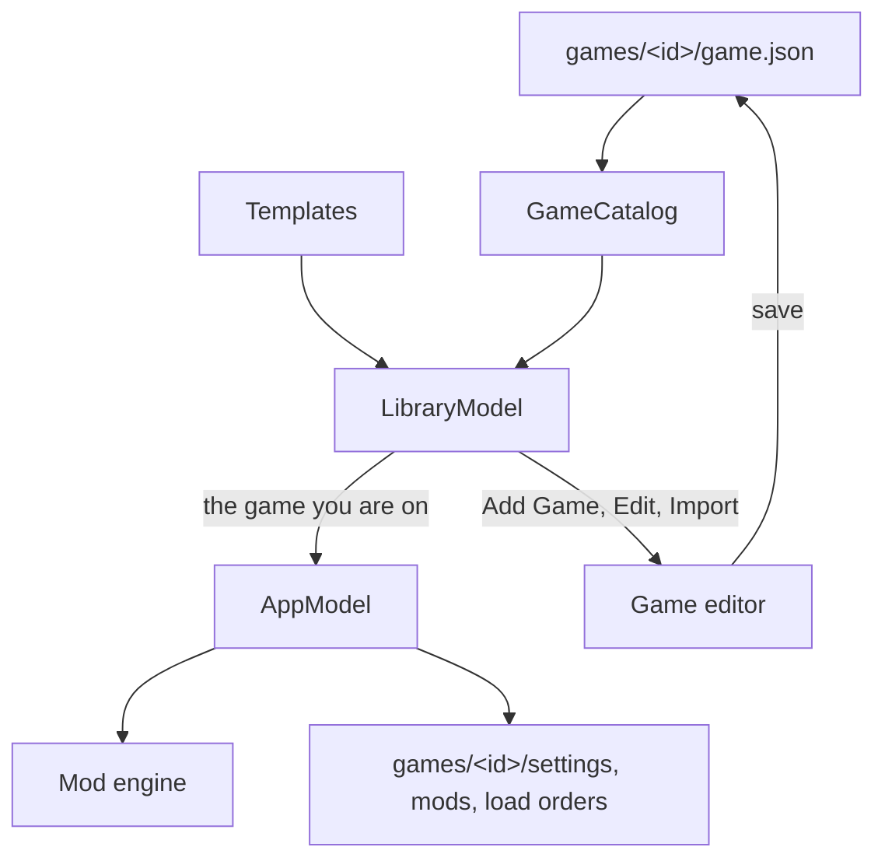

# How Graft works

## What happens when you press Play

```
 mods, options, language, title text, game build or game files changed since the last Play?
   │ no ─────────────────────────────────────────────────────► start the game
   │ yes
   ▼
 merge (TkSharp, the library TKMM uses)
   │ data files, text and the resource size table, for your text language
   │ each mod's code patches reported separately
   ▼
 check code (Capstone disassembler)
   │ ├─ writes into read-only code memory → moved to free writable memory, or left out
   │ ├─ changes code the Mac app patches itself → left out, with the place named
   │ └─ system calls, thread pointer, counters or register x18 → built into the app
   ▼
 rebuild needed?  (memory sizes changed, or code must be built in)
   │ yes → MacNativeGames' build_app.py, about a minute
   ▼
 data mods → the game's mod folder, with the manifest MacNativeGames' make_mod_manifest.py writes
 code mods → passed to the game at start (TOTK_PCHTXT), when the app supports it
   ▼
 start the game; after a crash, match the crashing address to the mod that wrote it
```

Graft doesn't change MacNativeGames. It uses MacNativeGames' own scripts (with the Python environment MacNativeGames creates in each game's work folder), its player mod folder, and the game's log.

Before writing the game's mod folder, Graft checks that the folder holds exactly the files it wrote last time, by name, size and date. If it doesn't (for example, a file was copied there or changed by hand), Graft moves that folder aside as `<version>.backup-<date>` instead of deleting it.

## Code mods without a rebuild

The game app can load code mods when it starts, if it can confirm they were made for its exact version. It checks against the version's ID, which MacNativeGames saves inside the app as `main.build-id`. An app built with an older MacNativeGames doesn't have that file, so code mods have to be built into it instead (about a minute each time you turn one on or off).

Graft works either way:

- **The app has `main.build-id`:** code mods take effect at the next Play. Graft rebuilds only when memory sizes change.
- **The app doesn't, but your MacNativeGames folder's `build_app.py` writes it:** the next rebuild adds it, and later code changes need no rebuild.
- **Neither, or a mod's code must be built in:** Graft builds code mods into the app.

In the last case, turning on your first mod or turning off your last one also rebuilds the app, even for mods without code. TKMM always adds a code patch that raises the shop item limit to 512, and Graft includes it whenever any mod is on.

## Project layout

```
Makefile                 Entry point for building, testing, installing and cleaning (make help lists the targets)
Package.swift            Swift package: the app, the command-line tool, ModKit and Capstone
Sources/
  ModKit/                Everything except the SwiftUI app itself, so it can be tested on its own (Swift library)
    Apply/               Applying mods, build planning, saved state
    Code/                Disassembly, relocation, combining code patches
    Engines/             The ModEngine interface, ModSupport (each kind of mod support and its typed settings), TkSharpEngine and FileModEngine
    Game/                Game definitions, the game store and templates, the game editor's draft and checks, app layout, versions, building, launching, mod folder, crash reports
    Library/             Mod models, load orders for each version (ModSetup, saved by ModSetupStore), badges, TKMM import
    Support/             Settings, setup checks, paths, running processes, file locks, hashing
  GraftApp/              The SwiftUI app: LibraryModel holds your games and the game editor, AppModel the game you are on; one file per main view, and window sizing
  GraftCLI/              The command-line tool, graft
  GraftMerge/            graft-merge, a small C# program around TkSharp that also reads .pchtxt files for Graft, with its solution file and global.json (the .NET SDK version and test runner)
Tests/
  ModKitTests/           Swift tests for ModKit, in folders that match ModKit's, with fixture files
  GraftAppTests/         Swift tests for the app's window sizes, card dragging, mod title height and status text
  GraftMergeTests/       C# tests for graft-merge and Graft's TkSharp changes
vendor/
  TkSharp/               TkSharp at the commit TKMM 2.1.6 uses (submodule)
  capstone/              Capstone 5.0.9 (submodule); only the core and ARM64 are compiled
  patches/               Graft's changes to TkSharp, applied by the build and test scripts
Resources/Templates/     A game template for each MacNativeGames port (see games.md)
Resources/Info.plist     The app bundle's Info.plist
Resources/AppIcon.icns   The app icon, made by make icon (scripts/make-icon.sh)
Resources/Licenses/      License texts that aren't in a submodule or a package (AGPL-3.0), copied into the app
scripts/                 build.sh, test.sh, install-dotnet.sh, common.sh, collect-licenses.sh, make-icon.sh, draw-icon.swift
docs/                    This documentation, CONTRIBUTING.md and screenshots
```

## How the app is organized

The app has two models:

- `LibraryModel` holds your games, the templates, the game editor, the **Found on This Mac** list, and the settings shared by every game when no game is open.
- `AppModel` holds the game you are on: its settings, its mod list and load order, and everything that applies mods and starts the game. There is at most one `AppModel` at a time, and switching games reuses it.



When Graft becomes the active app, `LibraryModel` reads the game definitions and templates again. Graft reads the files again only when one of them changed, so a definition changed in the editor, with `graft game import` or by hand takes effect without restarting. A change to the game you are on reaches `AppModel` right away, or after the current task when Graft is busy applying mods.

## How Graft talks to the merge helper

The Swift app and the C# helper talk through JSON. For each command:

1. Graft writes a configuration file in the game's folder: game files, keys, text language, and for a merge the load order to apply.
2. Graft runs `graft-merge --config <file> <command>`.
3. The helper writes progress lines to its error output and one result to its standard output.
4. Graft deletes the configuration file.

Both sides define the messages as types: Swift `Codable` structs, and C# records serialized with a source-generated `JsonSerializerContext`.

The helper exits with status 1 when a command fails, and its result then holds the error message. A command also fails when TkSharp logs an error, when the mod list wasn't saved, or when a mod wasn't removed.

The app and the command-line tool take turns instead of overwriting each other's work:

- Each helper command that reads or changes the mod library holds a lock on it while it runs.
- Applying mods or importing a TKMM library holds a second lock from start to finish.

## Verified

- With the same 8 mods, 2,277 of 2,278 merged files are byte-identical to TKMM 2.1.6's output; the resource size table has identical entries in a different order.
- Graft turns the original Teleport Anywhere patch into exactly the hand-made fix (7 instructions moved, 3 values dropped). The game runs with it, both built into the app and applied at launch; the original crashed within 45 seconds.
- 19 mods (8 from a TKMM library, 11 converted from an emulator's mod folder) merge into a mod folder that MacNativeGames' own manifest tool accepts.

## Known limits

- Mods that need an extra code module (`subsdk`) only partly work: the Mac app can't load those modules.
- Graft fixes code that keeps zero-initialized values in game code memory and reaches them through `adrp`, optionally followed by `add`, `sub` or `mov`, then loads, stores or atomic updates. It follows both sides of branches and keeps track across calls. When the address escapes where Graft can't follow it, for example into a game function's arguments or into memory, and it points into the mod's own read-only code, the mod's code is left out with that reason.
- The game needs an awake display to start; with the display asleep it stops at "native display link initialization".
- Graft follows a mod's registers through the mod's own code only. When the mod's code jumps back into the game, Graft assumes the game code doesn't use an address the mod left in a register.
- Tested on one Mac (macOS 27, Apple silicon).
