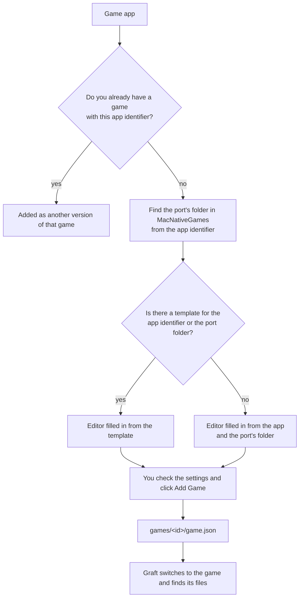
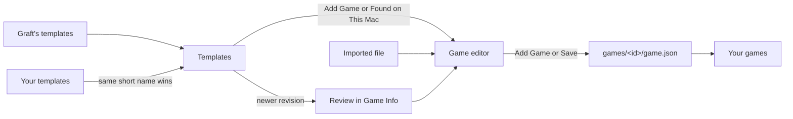
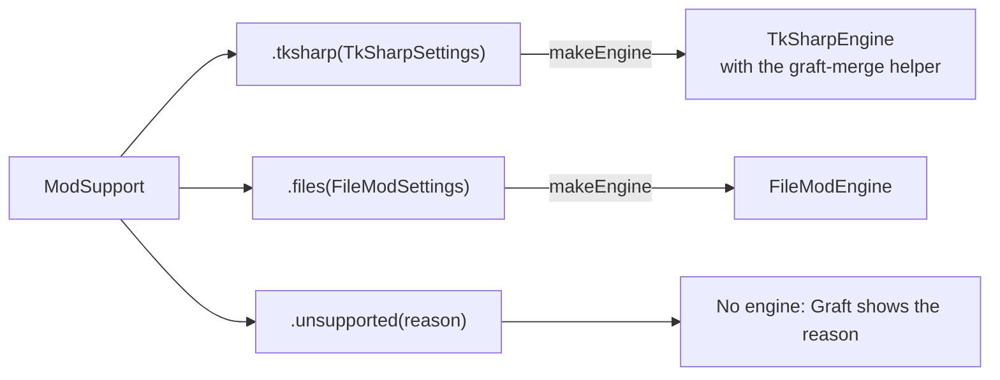

# Games

Graft works with games that MacNativeGames builds. Graft has no list of games built into its code. Instead, each game you add has a definition: a file that says how Graft finds the game's files and how it combines the game's mods.

You create and change definitions in the app. You can also export them, import them and share them.

## Mod support

What Graft can do with a game's mods depends on how the port loads mods. The definition's **Mod support** setting chooses one of three kinds:

| Mod support | What Graft does | Example |
| :-- | :-- | :-- |
| Merge with TkSharp | Merges mods file by file with TkSharp, the library TKMM uses, checks and fixes code mods, and can import a TKMM library | Tears of the Kingdom |
| Replace game files | Copies the mods that are on into the port's one mod folder, with higher mods winning when two mods have the same file | Octopath Traveler 0 |
| Not supported yet | Shows the game in the sidebar and says why its mods can't be managed yet | A port Graft has no way to combine mods for yet |

Each game keeps its own settings, and each version of a game keeps its own load order. Choose a game in the sidebar, or with `graft game <id>`.

## Adding a game

There are three ways to start:

- Drop a game app on Graft's sidebar, or on the window when you have no games yet.
- Choose **Add Game…** at the bottom of the sidebar, or File ▸ Add Game… (⇧⌘N).
- Click **Add…** next to a game under **Found on This Mac**. This section lists game apps that Graft has a template for and that you haven't added yet.

Graft then opens the game editor, already filled in:



- **From a template.** When the app matches one of Graft's templates, by its app identifier or by its folder in MacNativeGames, the editor starts with everything the template says. This includes settings Graft can't read from the app, such as the code-mod setting, the memory size table or the text languages.
- **From the app and MacNativeGames.** Otherwise Graft fills in what it finds in the app and in the port's folder in MacNativeGames: the name, app identifier, title ID, data folder and work folder. When the port has `scripts/make_mod_manifest.py`, Graft also sets **Mod support** to **Replace game files** with that script.

If Graft didn't find the port's folder, choose it under **Port folder** in the editor's **Game** tab, and Graft fills in the editor again from that folder.

Check the rest, then click **Add Game**.

From the command line, `graft game add <game app>` does the same with a template or with what Graft finds. It can't ask you anything, so it adds the game only when the definition is complete, and otherwise lists what's missing. An app for a game you already have is added as another version of that game, as in the app.

## The game editor

To change a game later, choose **Edit Game…** when you right-click a game in the sidebar, or click **Edit…** in the **Definition** section of Game Info. Both open the same editor.

Every setting of a definition is in the editor, in five tabs:

| Tab | Settings |
| :-- | :-- |
| Game | The name and short name, the title IDs of the game and its updates, the port's folder in MacNativeGames, the work folder and the folder inside it that holds the extracted game, the game's data folder, the app's identifier and file name, the Info.plist key that records the work folder, and the game's log |
| Files | Which paths the game needs (game app, base game, update, work folder), each with the label and the two explanations shown in Game Info and in the setup card |
| Mods | Mod support, and the settings of the kind you choose (below) |
| Versions | How a version such as 1.2.1 becomes a folder name such as `v121`, and versions whose folder doesn't follow that rule |
| Recognition | The file extensions and folders that mark a mod as made for this game, so Graft can refuse it when you add it to another game |

The short name can't change after the game is added, because Graft uses it for the game's folder.

The settings on the **Mods** tab depend on the mod support you choose:

| Mod support | Settings |
| :-- | :-- |
| Merge with TkSharp | The MacNativeGames scripts that rebuild the app, write the mod folder's manifest and list the places the app patches itself. Code mods: the setting that passes a code-mod file to the game when it starts, the memory size table, where the app records it, and the file that lets the app load code mods without a rebuild. Whether the title-screen text setting applies. The text languages, each with its code, its name and, if it exists only in some versions, those versions |
| Replace game files | Where loose `.pak` files go inside the game's files, the port's manifest script, the Python environment the port's build makes, and the folder inside the game app that holds the game's files |
| Not supported yet | The reason shown in the sidebar and in Game Info |

The editor checks every field as you type and lists anything wrong at the bottom. Click the list to see all of it.

When you switch **Mod support**:

- the files that kind of mod support needs are added to the **Files** tab, so the setup card asks for them;
- what you entered for each kind is kept until you close the editor, so switching back restores it;
- each kind keeps its own load orders, so switching an existing game to another kind and back brings its order, switches and options back.

If you save a change while Graft is applying mods, Graft finishes applying first and then uses the new definition. The same goes for a game you remove from the command line while the app is busy.

## Where definitions are kept

Graft keeps each game's definition in `~/Library/Application Support/Graft/games/<id>/game.json`, next to that game's settings, mods and load orders. **Show in Finder** in the **Definition** section of Game Info shows the file.

| Action | In the app | On the command line |
| :-- | :-- | :-- |
| Export a definition, for example to share it | **Export Game…** in the File menu, the sidebar's right-click menu, or Game Info | `graft game export <id> <file>` |
| Import a definition | **Import Game…** in the File menu opens the file in the editor, so you can check it before saving | `graft game import <file>` adds it directly |
| Remove a game | **Remove Game…** in the sidebar's right-click menu | `graft game remove <id>` |

An imported definition whose short name matches a game you already have replaces that game's definition.

Removing a game deletes only its definition. The game's mods, load orders and settings stay, so adding the game again brings them back.

## Templates

Templates are definitions that only fill in the editor. They never change a game you have added unless you review and save the change.

Templates come from two folders:

- Graft's own templates, one for each MacNativeGames port, in `Resources/Templates` (inside the app, `Contents/Resources/Templates`).
- Your templates, in `~/Library/Application Support/Graft/Templates`. **Show Templates Folder** in Settings opens it. A template of yours with the same short name as one of Graft's replaces Graft's.

`graft game templates` lists them.



A template has the same layout as an exported definition, plus a `revision` number. A game added from a template remembers which template and revision it came from.

When Graft has a newer revision of that template, the **Definition** section of Game Info says so:

- **Review…** opens the new template in the editor, so you see the changes before saving them.
- **Keep Mine** keeps your definition and stops the notice for that revision.

## The definition file

Everything the editor shows is in the file. A definition has these fields:

| Field | Meaning |
| :-- | :-- |
| `id`, `name` | The short name used by Graft and the command line, and the name shown to people. The short name uses lowercase letters, digits and hyphens |
| `titleId`, `updateTitleId` | Nintendo title IDs, used to find the base game and update files by name |
| `macNativeGamesFolder` | The game's folder under `games/` in MacNativeGames |
| `app.bundleIdentifier`, `app.fileName`, `app.workFolderKey` | The identifier MacNativeGames gives the game app, the app's file name when it isn't `<name>.app`, and the `Info.plist` key that holds its work folder. A port that has no game app yet leaves `app` out |
| `dataFolder` | The game's folder in `~/Library/Application Support/MacNativeGames`, which holds its mod folder |
| `workFolder`, `workTree` | The default work folder's name (the short name followed by `_build` when it is left out), and the folder inside it that holds the extracted game (none when it is left out or empty) |
| `log.file`, `log.linePrefix`, `log.enableVariable` | The game's log file in `~/Library/Logs/MacNativeGames`, the prefix of the game's own lines, and the game app setting that turns the log on |
| `versionFolders.prefix`, `versionFolders.exceptions` | How a version becomes a folder name, and the versions that don't follow the rule |
| `files` | The paths the game needs, each with a `role` (`gameApp`, `baseGame`, `update` or `workFolder`), a `label`, a `summary` and a `detail` |
| `modSignatures.extensions`, `modSignatures.folders` | File extensions and folders that mark a mod as made for this game |
| `mods.engine` | `tksharp`, `files` or `unsupported`. The other fields of `mods` belong to that kind |
| `mods` for `tksharp` | `buildScript`, `manifestScript` and `patchSitesScript` (relative to the MacNativeGames folder), `codeMods` (`launchVariable`, `heapTable`, `heapRecord`, `buildIdFile`), `titleText`, and `languages` (each with `code`, `name` and optionally `versions`) |
| `mods` for `files` | `pakFolder`, `manifestScript` (relative to the MacNativeGames folder), `python` (relative to the work folder) and `appGameFolder` |
| `mods` for `unsupported` | `reason` |
| `template` | The template and revision the game was added from. Exports leave it out |

## Checking definitions

The editor and the **Definition** section of Game Info check a definition as you use it. They check:

- every field: names, short names, title IDs, the app identifier, files listed twice or without a label, version folder exceptions, and the fields the chosen mod support needs;
- against your MacNativeGames folder: that the port's folder exists and that every script the definition names is there.

If a script the game needs is missing from your MacNativeGames folder, the game also shows the problem before Play, instead of failing partway through.

If the definition file of the game you are on can't be read, for example after a hand edit left a stray comma, Graft keeps using the definition it read before and blocks Play until you fix the file or save the game again with **Edit Game…**. It doesn't switch to another game. A file that can't be read at all is listed in Settings and on the welcome screen.

`graft game check` checks every game's definition and prints what is wrong. It also says when Graft has a newer template for a game, and exits with status 1 if anything is wrong. Settings, `graft settings` and `graft game` show definition and template files that couldn't be read.

## Testing against MacNativeGames

Graft also reads a few messages that MacNativeGames prints, such as the one that says a mod folder changes nothing. Two tests check a MacNativeGames checkout:

- one checks every template's folders and scripts against it;
- one checks that those messages still appear in its scripts and runtime.

To run them, point `GRAFT_MACNATIVEGAMES` at the checkout:

```sh
GRAFT_MACNATIVEGAMES=~/Projects/MacNativeGames make test
```

Without the variable, both tests are skipped.

## Adding mod support for a new kind of port

How a game's mods are combined is the one part that is code. Each kind of mod support is a case of the `ModSupport` enum in `Sources/ModKit/Engines/ModSupport.swift`:



`ModSupport.Kind` names each case, and gives the title and description the editor shows and the mod files the kind takes.

Each case except `unsupported` carries a settings type that implements the `ModEngineSettings` protocol:

| Member | What it does |
| :-- | :-- |
| `scripts` | The MacNativeGames scripts the kind needs, which the checks look for |
| `problems()` | What is missing or wrong in the settings |
| `makeEngine(settings:paths:)` | Makes the engine that lists, adds and removes the game's mods and applies a load order. The engine implements the `ModEngine` protocol in `Sources/ModKit/Engines/ModEngine.swift` |

There are two engines:

- `TkSharpEngine`, for `TkSharpSettings`, merges Tears of the Kingdom mods file by file. TkSharp reads only that game's files, and the TKMM import and title-screen text are tied to it.
- `FileModEngine`, for `FileModSettings`, is for ports that load one mod folder of replacement game files. It does not merge the inside of files, and it does not handle code patches or cheats. When it applies, it:
  1. copies the mods that are on into one folder, with higher mods winning when two mods have the same file;
  2. writes the folder's manifest with the port's script, against the game files inside the app;
  3. installs the folder as the game's mod folder (`<dataFolder>/mods/<version>`) the same way as for Tears of the Kingdom, so a folder Graft didn't write is moved aside rather than replaced.

Graft itself keeps each version's load order, on/off switches and option choices (`ModSetup`), and passes them to the engine when it applies.

A port whose mods one of these engines can handle needs only a definition. A port that needs a new way of combining mods needs three things:

1. a new `ModSupport` case;
2. a settings type that implements `ModEngineSettings`;
3. an engine that implements `ModEngine`.

The compiler then points to every place that has to handle the new case, including the editor's **Mods** tab.
