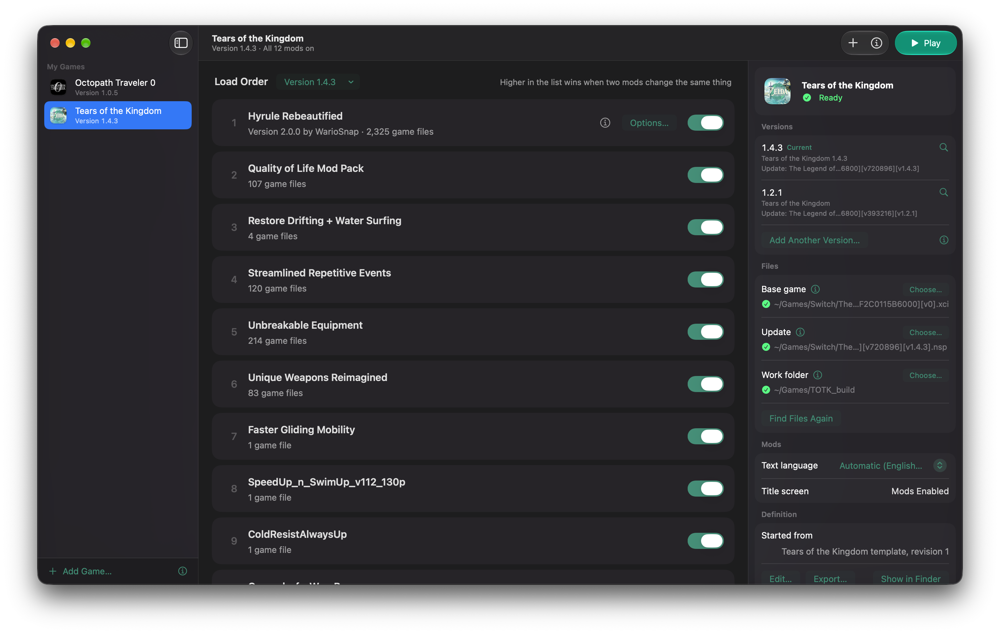

# Using Graft



## What Graft does

- **Combines your mods** with TkSharp, the library TKMM uses, so mods and TKMM libraries you already have keep working. Graft can import your TKMM library on first start.
- **Checks code mods before they run.** Some mods written for the Switch store values inside the game's code, which the Mac keeps read-only, so they crash. Graft moves those values to writable memory and marks the mod **Fixed for Mac** (Teleport Anywhere is one example). Code that can't run on the Mac is left out, with the reason.
- **Explains what each mod changes**, such as "2,325 game files" or "Game code".
- **Names the mod behind a crash** and offers to turn it off.
- **Recognizes mods made for another game** and refuses them instead of adding them to the wrong one.
- **Rebuilds the game app only when it has to**, for example when a mod changes the game's memory sizes.

## The mod list

Drag a mod's card up or down to change the load order. The position numbers change as you drag, and the right-click menu has **Move to Top** and **Move to Bottom**. Each version of each game has its own list of mods, with its own order, on/off switches and options. A mod you add goes into the version you are on.

Right-click a mod for more:

- **Move to Version ▸** takes the mod out of this version and adds it at the bottom of the version you choose, with the same on/off state and options.
- **Copy to Version ▸** adds it to the version you choose and keeps it here too. A version that already has the mod is greyed out.
- A version you haven't opened yet first gets a copy of this version's list, the same list it would start with if you switched to it, so moving or copying a mod there keeps its place in that list. Game apps with the same version number share one list, so they aren't offered here.
- **Remove from <version>…** takes it out of this version only. When no other version uses it, its files are deleted from Graft's library, and the confirmation says so.

A mod's files are stored once per game, however many versions use it.

Adding another copy of a mod you already have (same name and author) replaces it in every version that has it, keeping its place, its on/off state and its options there. If the older copy had code for a game version the new copy doesn't cover, that code is kept, so a mod keeps working on every version you have used it with. Use **Options…** on mods that have options. Changes to the list take effect when you press **Play**.

A badge appears only when there is something to know:

| Badge | Meaning |
| :-- | :-- |
| Fixed for Mac | Its code kept values in the game's read-only code memory; Graft moved them to writable memory |
| Partly works | It includes an extra code module (`subsdk`) the Mac app can't load; the rest of the mod applies |
| Cheats not used | It includes cheats, which the Mac app doesn't load |
| Not for 1.2.1 | It only has code, and the code is for another version of the game, so the mod does nothing |
| Code not for 1.2.1 | Its code is for another version of the game and is left out; its game files still apply |
| Won't work | Its code can't run on the Mac; hover over the badge for the reason |

The version in the badge is the version of your game app.

## More than one version of a game

You can keep a game app for each version of a game, for example one for 1.2.1 and one for 1.4.3.

The **Version** button next to the Load Order heading shows the version you play. Its menu lists, newest first, every game app MacNativeGames built for the game that Graft finds in these places:

- next to your game files;
- in your Games folder and the folders inside it;
- in `~/Applications` and in `/Applications`.

The menu also has these commands:

- Choosing a version switches the game app, its update file and the load order shown below it.
- **Copy Load Order From** copies another version's order, switches and options into the current one. Mods that no other version has stay in the list.
- **Add Another Version…** adds a game app from somewhere else. Dropping the app on the sidebar does the same.

**Versions** in Game Info lists each version's game app and update file.

Each version needs the update file for that version. Graft reads the version stored inside each update file in your Games folder, and in the folders of the files you already chose, and uses the one that matches the game app, so file names don't matter. It checks this whenever Graft opens and whenever you switch versions. If no update file matches, the setup card asks you for the update of that version.

Each version keeps its own list of mods, order, on/off switches and options. A version you open for the first time starts with the list of the version you came from. Graft uses each code mod's code for the version you play, and the badges show which mods do nothing on that version. The first Play after switching applies your mods for that version.

### Load order files

Graft keeps each version's load order in `~/Library/Application Support/Graft/games/<game>/setups/<engine>/<version>.json`, where `<engine>` is the kind of mod support (`tksharp` or `files`). The file lists the mods from top to bottom, whether each is on, and the options chosen in each option group (by name).

- **File ▸ Export Load Order…** saves the current version's file anywhere.
- **File ▸ Import Load Order…** replaces the current version's order with one from a file. It matches mods by their ID and then by name, turns off mods the file doesn't list, and names any mods in the file that aren't in your library.

## The File menu

| Command | Shortcut | What it does |
| :-- | :-- | :-- |
| Add Game… | ⇧⌘N | Adds a game app MacNativeGames built |
| Import Game… | | Opens a game definition file in the game editor, to add it or replace the game it describes |
| Export Game… | | Saves this game's definition to a file |
| Import Load Order… | | Replaces this version's load order with one from a file |
| Export Load Order… | | Saves this version's load order to a file |
| Apply Mod Changes | ⌘R | Merges and installs your mods now, without starting the game |
| Rebuild Game App | ⇧⌘R | Applies your mods and rebuilds the game app even if nothing requires it. Use it when the game app and Graft's records disagree, for example after you rebuilt the app outside Graft |

**Play** (⌘P) applies your changes first when there are any, then starts the game.

If you quit Graft while it is applying mods or rebuilding the game app, it asks first. Quitting stops that work, including the MacNativeGames build and the merge helper Graft started, and the next Play starts it again.

## Crashes

If the game crashes, Graft names the mod whose code was running and offers to turn it off. This works even if Graft was closed while you played: Graft checks the game's log the next time it opens.

The game writes this log only while **Keep a game log** is on in Settings. Graft passes the setting to the game each time it starts it.

## Your games

The sidebar lists the games you added, with each one's icon and the version you play; choosing one shows its mods. A game Graft can't manage mods for yet says so under its name. **Found on This Mac** below it lists game apps Graft has a template for that you haven't added yet. When you have no games, the window shows the same list with **Add Game…** and **Import Game…**.

To add a game, drop its app on the sidebar, click **Add…** next to it under **Found on This Mac**, or choose **Add Game…** at the bottom of the sidebar (or File ▸ Add Game…, ⇧⌘N). Graft opens the game editor, filled in from its template for that game or from what it finds in the app and in MacNativeGames, and checks every field as you type. An app for a game you already have is added as another version of it.

Right-click a game to show its app in Finder, add another version, edit, export or show its definition, or remove it. Removing a game keeps its mods, load orders and settings, so adding it again brings them back. [Games](games.md) explains definitions, the editor and templates.

## Game info

**Game Info** (the ⓘ button, or ⌘J) opens a panel beside the mod list for the game you are managing:

- Whether the game is ready, and anything that needs attention, with a button to fix it.
- **Versions**: each version's game app and update file, with a button to show the app in Finder.
- **Files**: the game app, game files and work folder, and **Find Files Again**.
- **Mods**: the text language for mods and the title-screen text, for games that have them.
- **Definition**: which template the game started from, anything wrong with its definition, and buttons to edit, export or show it. When Graft has a newer template for the game, this section offers to review it.

Each file and folder has an ⓘ button that explains what to choose, and hovering a path shows it in full.

## Settings

Settings has the settings shared by every game: the MacNativeGames folder, your keys folder, and whether the game keeps a log. It works before you add a game. **Show Templates Folder** opens the folder for your own game templates.

### Where Graft looks for files

When a game has no saved settings, Graft searches these places:

| What | Where |
| :-- | :-- |
| Game app | Next to your base game and update files (where MacNativeGames puts it by default), `~/Games` and the folders inside it, `~/Applications`, `/Applications` |
| Base game and update files | `~/Games` and up to three folders below it, matched by the game's title ID |
| MacNativeGames folder | A `MacNativeGames` folder in `~/Projects`, `~/Developer`, `~/Code`, `~/src` or your home folder |
| Keys folder | `~/.switch`, `~/Games/Switch/keys`, Ryujinx's `system` folder, the folder with your base game, or a `keys` folder next to it |
| Work folder | The folder the game app records, if the port records it; otherwise `~/Games/<work folder>`, a `<work folder>` next to your base game, or one inside the game's folder in MacNativeGames |

There are two **Find Files Again** buttons:

- **Find Files Again** in Game Info searches for the game's files, in the places in the table and also in Downloads and Documents. macOS asks once before Graft can look there, and remembers your answer for the copy of Graft you have. After you rebuild Graft, it asks again.
- **Find Files Again** in Settings searches only for the MacNativeGames folder and the keys folder, in the places in the table.

Both buttons keep a path you chose yourself when the search finds nothing for it.

Graft keeps each game's mods, settings and state in `~/Library/Application Support/Graft/games/<game>`, and the shared settings in `~/Library/Application Support/Graft/settings.json`.

## Command line

Graft includes a command-line tool, `graft`, for adding games, setup, adding mods, applying and playing. Turning mods on or off, reordering, removing mods and choosing options are done in the app; `graft setup import` can replace a version's whole load order with one from a file.

The tool is inside the app, at `Graft.app/Contents/Helpers/graft`. `make install` links it as `~/.local/bin/graft`, so it runs as `graft` when `~/.local/bin` is on your `PATH`. To link it yourself instead, for example with Graft in `/Applications`:

```sh
mkdir -p ~/.local/bin
ln -s /Applications/Graft.app/Contents/Helpers/graft ~/.local/bin/graft
```

`make install` puts Graft in `/Applications`. A copy built with `make build` but not installed is at `.build/app/Graft.app` in the repository.

`graft help` prints:

```
usage: graft <command>

  game [id]                      list your games, or switch to one
  game add <game app>            add a game from its app, or another version of a game you have
  game import <file>             add a game from a definition file, or replace the one with its id
  game export <id> <file>        save a game's definition to a file
  game remove <id>               remove a game; its mods and load orders stay
  game check                     check every game's definition
  game templates                 list the game templates
  version [game app]             list the versions of this game, or switch to one and its matching update
  setup [export|import <file>]   show this version's load order file, or export or import it
  settings                       show the settings and any problems
  detect                         search for paths, also in Downloads and Documents, without saving
  check-code <file.pchtxt>       check whether a code mod works on the Mac
  import-tkmm                    copy TKMM's mod library
  list                           list the mods in load order
  install <path>                 add a mod from a file or folder
  apply [--rebuild]              merge mods, check code, rebuild if needed, install data mods
  play                           start the game with the mods last applied
  crash                          explain why the game last stopped
```

`graft --help` and `graft -h` print the same list. An unknown command or wrong arguments print the list to standard error and exit with status 2.

Some details of the commands:

- `graft game add` adds a game the way Add Game does, but it can't ask you anything. It adds the game only when its template, or what Graft finds in the app and in MacNativeGames, is complete, and otherwise lists what's missing. An app for a game you already have is added as another version of it.
- With no games added, commands other than `game` say how to add one.
- The first command run before any settings are saved finds and saves them, as the app does when it first opens.
- `graft detect` searches Downloads and Documents like **Find Files Again** in Game Info, so macOS may ask whether Terminal can access those folders.
- `apply` and `play` first check the same setup problems the app shows, and stop if there are any.
- `play` starts the game with the mods as they were last applied, so run `apply` first after you change the load order.
- Pressing Ctrl-C stops `graft` and the MacNativeGames build or merge helper it started, so nothing keeps running in the background.
- `graft version <game app>` switches to that game app and its matching update file. A version you switch to for the first time starts with the load order of the version you came from, as in the app.
